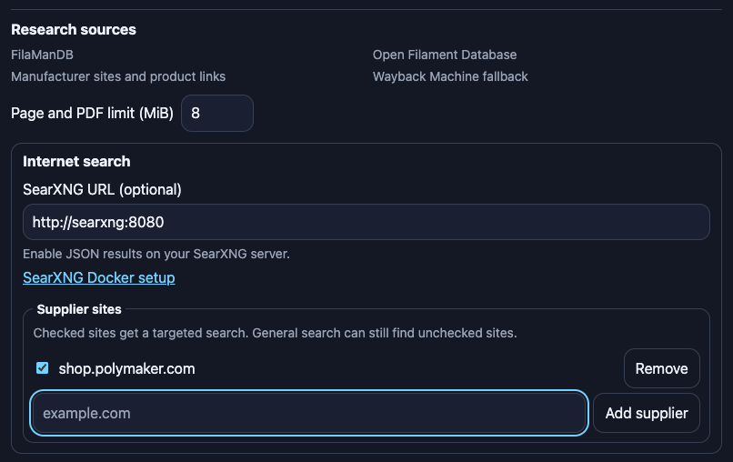
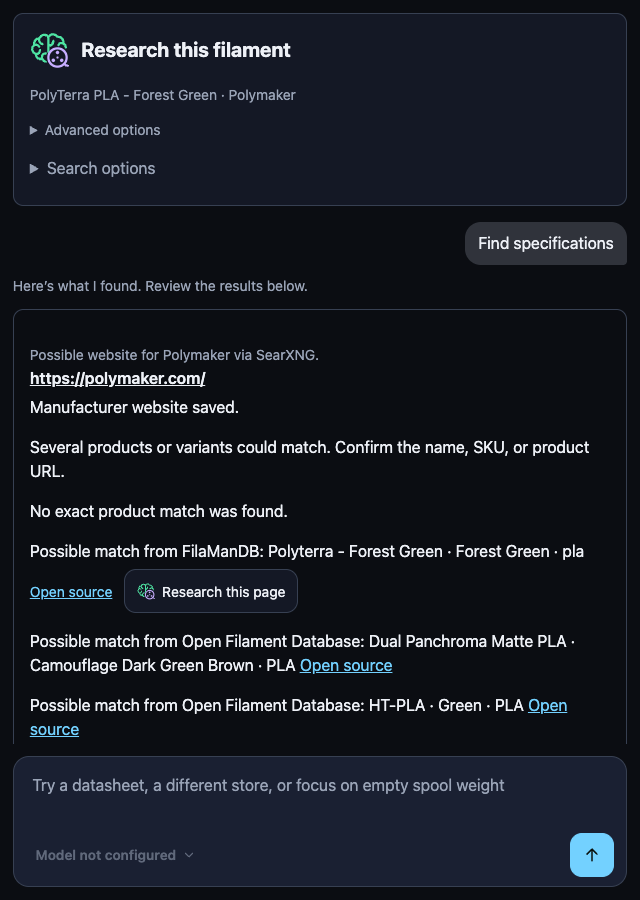

# FilaBrain for FilaMan


FilaBrain is a FilaMan integration plugin maintained by `akira69`. It uses the FilaMan library, checks manufacturer and catalog sources, and presents proposals for review. It supports an OpenAI-compatible model server, including Ollama, and can expose its tools to a separate MCP client.

## Install

**Development preview.** This package targets FilaMan 2.0.5+. Review researched values before applying them to your inventory.

### What's new in 0.1.17

- Find manufacturer datasheets from product links and sitemaps, including when web search is unavailable. Each proposed value shows its own source.
- Reopen research chats from History with variant warnings and citations intact. The editor shows lookup failures and keeps remaining suggestions visible after staging fields.
- Test model and SearXNG connections separately, review selected filaments in batches, and use read-only research through FilaMan's built-in MCP on supported hosts.

To build the preview ZIP from source, run the packaging script with Python 3. Published preview ZIPs appear under GitHub Releases.

```sh
python3 scripts/package_plugin.py
```

Upload the ZIP from `dist/` under **Admin → System → Plugins**. Enable **FilaBrain**, then open it from the FilaMan sidebar. Configure the model and optional search server in the plugin's settings. Open **Guide** from the FilaBrain page or chat for Ollama, OpenAI and Claude model setup, research workflows, and external MCP connections.

The package includes the FilaBrain sidebar icon and uses FilaMan’s filament editor and selected-filament integration hooks.

For PDF datasheet extraction, install Poppler (`poppler-utils` on Debian and Ubuntu) in the environment running FilaMan. For a Docker deployment, include it in the FilaMan image so it survives container recreation. Without `pdftotext`, FilaBrain can link to PDFs for manual review.

Rebuild the bundled page after editing the icon or files in `frontend/`.

```sh
npm ci
npm run build
python3 scripts/package_plugin.py
```

## Optional SearXNG search

Attach the search container to the Docker network used by FilaMan and enter `http://searxng:8080` as the search URL in the plugin.

```sh
FILAMAN_NETWORK=your-filaman-network docker compose -f compose.searxng.yml up -d
```

The search service stays on that Docker network and serves JSON results. The bundled configuration enables Yandex alongside the default engines so searches can still return results when a default engine is unavailable. For an existing Compose deployment, recreate the SearXNG container to load the updated configuration. When a public product page blocks access, FilaBrain can check a dated Wayback Machine capture if one is available.

**Research sources** lists the built-in sources. Add supplier domains under **Internet search** to include them in targeted SearXNG searches. General search can still find unchecked sites. The page and PDF download limit defaults to 8 MiB per file and can be changed under **Research sources**. When a page exceeds the limit, FilaBrain looks for a more specific product page or datasheet in the supplier’s sitemap or through a targeted search.



When a manufacturer's website is missing, FilaBrain checks FilaManDB first and can look for a matching brand site through SearXNG. In the filament editor, users who can edit both the filament and its manufacturer can review the suggested URL and select **Save manufacturer website** to update the manufacturer record.



## External MCP connections

On FilaMan 2.1.0 or later, use the built-in MCP for general inventory work. Go to **Admin → App Settings → AI Assistants (MCP)** for client setup. The built-in endpoint is `/mcp` and uses `Authorization: ApiKey <FilaMan API key>`.

Use FilaBrain's MCP to research filament specifications or send proposals to an open filament editor for review. Turn on **Enable the FilaBrain MCP endpoint** in FilaBrain's settings and configure your client for Streamable HTTP at `/api/v1/filabrain/mcp` on the FilaMan origin. Use a FilaMan API key as the bearer token. The plugin checks the key's permissions for each tool.

FilaMan's **Allow write access** setting applies only to the built-in endpoint. FilaBrain's separate **Enable the FilaBrain MCP endpoint** switch controls its endpoint, where permitted keys can still create filaments and spools while the built-in server is read-only.

Remote connections require HTTPS. If an HTTPS reverse proxy terminates TLS for FilaMan, configure the proxy to preserve the public `Host` and overwrite `X-Forwarded-Proto` with the scheme it received. Set `FILABRAIN_MCP_TRUSTED_PROXY_IPS` in the FilaMan process or container environment to the exact source IP of that proxy as seen by FilaMan. Separate multiple proxy IPs with commas. Keep direct clients off the proxy addresses.

### Research through FilaMan's built-in MCP

On a FilaMan build with plugin MCP tool support, enable the built-in MCP server and add `filabrain-research_filament` to the host's `MCP_PLUGIN_READ_TOOLS` environment setting. Restart FilaMan. Connect to `/mcp` with `Authorization: ApiKey <FilaMan API key>` and give the key `filaments:read` access. Use HTTPS for remote clients. The tool returns suggestions and sources for review without saving them. It works with FilaBrain's separate endpoint switched off. Use the separate endpoint for pairing a client to an open editor.

## Verify a package

Run the smoke test with the Python environment from a stock FilaMan checkout.

```sh
python scripts/smoke_install.py /path/to/filaman-system dist/filabrain-0.1.17.zip
```

The test installs the ZIP into a temporary plugin directory and uses an isolated SQLite database.

[MIT license](LICENSE.md)
