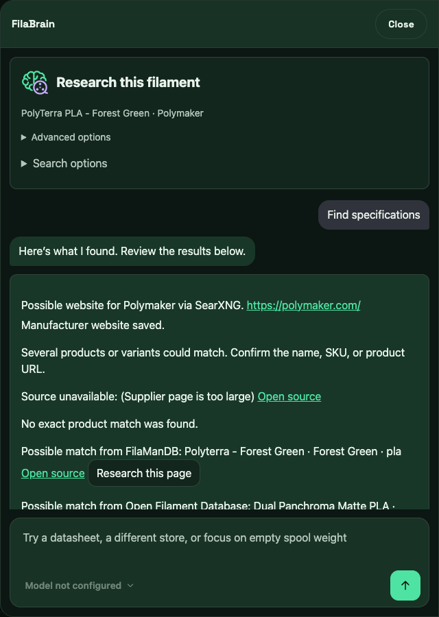

# FilaBrain for FilaMan


FilaBrain is a FilaMan integration plugin maintained by `akira69`. It uses the FilaMan library, checks manufacturer and catalog sources, and presents proposals for review. It supports multiple OpenAI-compatible model endpoints, including Ollama, and exposes research through FilaMan’s built-in MCP server.

## Install

**Development preview.** Verified on stock FilaMan 2.2.2. Review researched values before applying them to your inventory.

### What's new in 0.1.25 (development preview)

- Select filaments in Research library and choose Color audit to review RAL/Pantone references, manufacturer color names and shared swatch naming.
- Proposed shared names use the official publisher preview. Confirm each rename after reviewing how many filaments use the swatch; HEX and manufacturer color names remain unchanged by a shared rename.
- Correct a filament’s preview separately by keeping, reusing or creating a swatch. No automatic palette merging or global recoloring.

### Added in 0.1.24

- Open the same Chat and Research workspace from the sidebar or a filament editor. Editor research keeps its current target separate from new-filament drafts, and chat preloads the selected filament.
- Create a manufacturer or palette color while building a filament. RAL/Pantone previews offer matching swatches by hex, independent of their names, while keeping the manufacturer's color name.
- Explicit spool choices can replace reviewed measurements, and color/spool selections remain in the final saved draft.
- Find Paramount products from sparse descriptions or formatted SKUs using official product indexes, with bundled links available during index outages. Current pages still verify each candidate.

Standalone creation works on FilaMan 2.2.2 or later. Staging new palette records or changing a color inside the native editor requires FilaMan's updated palette-staging support. Older hosts show color previews without unsupported staging actions.

### Added in 0.1.23

- Research library color filters overlay the page without enlarging or shifting the filament list.
- Small side insets separate the table from the panel edges. Table headers stay visible while scrolling through filaments.

### Added in 0.1.22

- Find products from an SKU, product link, or a description such as “Paramount 3D PLA purple.” Review candidate cards and source links before choosing a product.
- SKU discovery checks formatting variants and nearby matches, while preserving your explicit product constraints. Details remain available for precise searches.
- Bounded lookups use live and bundled catalogs, distinguish incomplete searches from no matches, and keep retailer codes separate from manufacturer SKUs. Candidate discovery needs no model and never saves inventory changes.
- Spool choices survive chat tab changes, and printer context refreshes its loaded-filament suggestions.

To build the preview ZIP from source, run the packaging script with Python 3. Published preview ZIPs appear under GitHub Releases.

```sh
python3 scripts/package_plugin.py
```

Upload the ZIP from `dist/` under **Admin → System → Plugins**. Enable **FilaBrain**, then open it from the FilaMan sidebar. Configure the model and optional search server in the plugin's settings. Open **Guide** from the FilaBrain page or chat for OmniRoute, Ollama, and other model setups, research workflows, and external MCP connections.

The package includes the FilaBrain sidebar icon and uses FilaMan’s filament editor and selected-filament integration hooks.

For PDF datasheet extraction, install Poppler (`poppler-utils` on Debian and Ubuntu) in the environment running FilaMan. For a Docker deployment, include it in the FilaMan image so it survives container recreation. Without `pdftotext`, FilaBrain can link to PDFs for manual review.

Rebuild the bundled page after editing the icon or files in `frontend/`.

```sh
npm ci
npm run build
python3 scripts/package_plugin.py
```

## How filament lookup finds sources

FilaBrain checks saved product links and searches using the product name, material, color, and any SKU. It also recognizes imported article numbers and can check a manufacturer's sitemap when it hasn't found a matching product page.

A product page can supply color codes from its text or URL. A related listing can supply a color reference when the manufacturer identifies the same product group, material, and color, and any stated finish matches. Its dimensions, temperatures, and other variant specifications still need evidence for the filament being researched.

RAL and Pantone previews come from the respective publisher’s page or displayed swatch, not a third-party conversion table. The reusable color name includes the standard reference, for example `Purple violet (RAL 4007)` or `Pantone 7449 C`; the filament keeps its manufacturer color name, such as `Decepticon Purple`. HEX is a screen preview, not a measured match to printed plastic. If the publisher preview is unavailable, FilaBrain keeps the reference without inventing a HEX. Existing colors are not renamed or recolored automatically.

## Model endpoints

Open **FilaBrain settings** and use **Add endpoint** for each model server. Give it a name, enter its URL and API key if required, then load models or enter a model ID manually. Use **Models shown in chat** to choose which models appear under that endpoint in the chat picker. Save your changes after testing the connection. **Make default** sets the endpoint and model that new conversations and background research batches use.

### Microphone dictation

Enable or disable the microphone under **Settings → Microphone**. Choose **Browser dictation**, which may use the browser’s online speech service, or select a configured transcription endpoint. OS keyboard dictation remains independent.

For endpoint transcription, enable **Audio transcription** on a model connection and enter its transcription model ID. Leave **Chat** enabled too if the connection serves both. The server must support the standard `/audio/transcriptions` API; a chat model alone does not establish audio support. No speech service or model is installed automatically.

Recordings are limited to 60 seconds. Endpoint mode sends audio through FilaMan to the selected service when recording stops; FilaBrain does not save the audio. Review the editable transcript and press **Send** to submit text to chat. Capture requires HTTPS and a supported browser. Manufacturer names can be misrecognized, including in the live Ollama test, so check the transcript.

### Recommended hosted setup with OmniRoute

Use **Qwen 3.8 27B through Groq** for chat and interactive research. In one matched FilaBrain test, it recovered the same nine specs and conflicting nozzle ranges as local Qwen 27B. Extraction took 1.7 seconds through OmniRoute and 33.9 seconds locally on an NVIDIA V100 with 32 GB of VRAM. [Model benchmark](docs/local-model-evaluation.md#omniroute-and-local-qwen)

1. Install or open your OmniRoute server. In its dashboard, open **Providers → Groq** and connect your Groq API key. Groq offers Qwen 3.8 27B on its rate-limited free plan. [OmniRoute setup](https://github.com/cheaper-inference/OmniRoute) · [Create a Groq API key](https://console.groq.com/keys) · [Groq model](https://console.groq.com/docs/model/qwen/qwen3.8-27b) · [Groq rate limits](https://console.groq.com/docs/rate-limits)
2. In FilaBrain’s **Model settings**, choose **Add endpoint** and enter `http://<omniroute-host>:20128/v1` or your configured HTTPS URL. Use an address reachable by the FilaMan server. Paste the **OmniRoute endpoint key** from its dashboard into FilaBrain.
3. Choose **Load models**, select `groq/qwen/qwen3.8-27b`, then **Test connection** and **Save**. Use **Make default** to make it your starting model. The OmniRoute key must allow that exact model.

With a hosted model, FilaBrain sends your question and relevant FilaMan context to the provider.

### Run Ollama locally

Install and start Ollama, then download the tested starting model on the Ollama machine.

```sh
ollama pull qwen3:4b-instruct
```

In FilaBrain's **Model settings**, add an endpoint with a URL such as `http://ollama:11434/v1` on a shared Docker network or `http://<ollama-host>:11434/v1` on a private LAN. Use the address reachable by the FilaMan server. Leave the API key blank for a standard local Ollama server. Select **Load models**, pick your model, then use **Test connection** and **Save**. [Ollama installation](https://docs.ollama.com/quickstart) · [Ollama network setup](https://docs.ollama.com/faq#how-can-i-expose-ollama-on-my-network)

Try a materials question in Chat and inspect **Sources and inventory**. Small local models can use the bundled references for offline questions. Use the sourced cards for exact specifications and review research suggestions before saving them.

### Other hosted providers

To use OpenRouter directly, add `https://openrouter.ai/api/v1` with an OpenRouter API key. Choose an available model with the `:free` suffix to use the free tier, then test the connection. [OpenRouter free models and limits](https://openrouter.ai/collections/free-models)

## Optional SearXNG search

Attach the search container to the Docker network used by FilaMan and enter `http://searxng:8080` as the search URL in the plugin.

```sh
FILAMAN_NETWORK=your-filaman-network docker compose -f compose.searxng.yml up -d
```

The search service stays on that Docker network and serves JSON results. The bundled configuration enables Yandex alongside the default engines so searches can still return results when a default engine is unavailable. For an existing Compose deployment, recreate the SearXNG container to load the updated configuration. When a public product page blocks access, FilaBrain can check a dated Wayback Machine capture if one is available.

**Research sources** lists the built-in sources. Add supplier domains under **Internet search** to include them in targeted SearXNG searches. General search can still find unchecked sites. The page and PDF download limit defaults to 8 MiB per file and can be changed under **Research sources**. When a page exceeds the limit, FilaBrain looks for a more specific product page or datasheet in the supplier’s sitemap or through a targeted search.


When a manufacturer's website is missing, FilaBrain checks FilaManDB first and can look for a matching brand site through SearXNG. In the filament editor, users who can edit both the filament and its manufacturer can review the suggested URL and select **Save manufacturer website** to update the manufacturer record.



## External MCP connections

**Switch to FilaMan’s built-in MCP.** If your client used `/api/v1/filabrain/mcp`, change the URL to `/mcp` on the same server. Replace `Authorization: Bearer <key>` with `Authorization: ApiKey <FilaMan API key>`. For remote connections, use HTTPS.

1. In FilaMan, enable **AI Assistants (MCP)** under **Admin → App Settings**. Use `list_filaments` to verify the connection. Inventory changes require **Allow write access** and the appropriate permissions.
2. For filament research, use FilaMan **2.2.2 or newer**. Add `filabrain-research_filament` to the host’s comma-separated `MCP_PLUGIN_READ_TOOLS` setting and restart FilaMan. With Docker Compose, add the setting to `.env` and run `docker compose up -d`.
3. Call `filabrain-research_filament` with a key that has `filaments:read` access. Suggestions and sources appear in your MCP client for review. To continue in FilaMan, open the filament and review any changes in its editor.

## Verify a package

Run the smoke test with the Python environment from a stock FilaMan 2.2.2 or newer checkout.

```sh
python scripts/smoke_install.py /path/to/filaman-system dist/filabrain-0.1.25.zip
```

The test installs the ZIP into a temporary plugin directory and uses an isolated SQLite database. Pass `--previous path/to/old.zip` to test upgrade and rollback. The smoke test covers offline catalog research through FilaMan's built-in MCP and printing chat with a local test model. Use `--live-model` with `FILABRAIN_MODEL_URL` and `FILABRAIN_MODEL_ID` to exercise a configured server.

Run the 25-product benchmark against the stock host. The report records wrong values, missing coverage, and source links. Add `--offline` to test the bundled catalog and `--case CASE_ID` to rerun specific records.

```sh
python scripts/research_benchmark.py /path/to/filaman-system
```

[Small-model evaluation and team guidance](docs/local-model-evaluation.md)

[MIT license](LICENSE.md)
