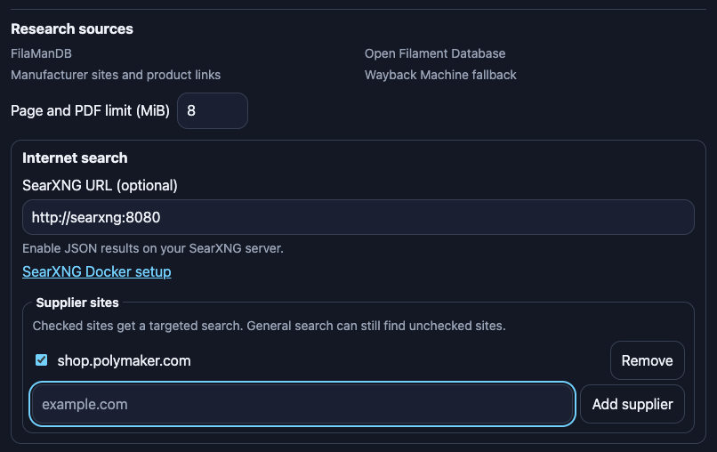

# FilaBrain for FilaMan


FilaBrain is a FilaMan integration plugin maintained by `akira69`. It uses the FilaMan library, checks manufacturer and catalog sources, and presents proposals for review. It supports multiple OpenAI-compatible model endpoints, including Ollama, and exposes research through FilaMan’s built-in MCP server.

## Install

**Development preview.** This package targets FilaMan 2.0.5+. Review researched values before applying them to your inventory.

### What's new in 0.1.18

- Connect multiple named model endpoints and choose which models appear in chat and interactive research. Set the default used for new conversations and background runs.
- Use the compact mobile navigation and review research runs with source links next to the proposed changes.
- Compare RAL and Pantone previews with the filament's saved swatch. Keep the current swatch, reuse an existing one, or create one after reviewing the reference.
- Find more manufacturer listings through product links, article numbers, and sitemaps, with variant checks before FilaBrain proposes a purchase link or color reference.

To build the preview ZIP from source, run the packaging script with Python 3. Published preview ZIPs appear under GitHub Releases.

```sh
python3 scripts/package_plugin.py
```

Upload the ZIP from `dist/` under **Admin → System → Plugins**. Enable **FilaBrain**, then open it from the FilaMan sidebar. Configure the model and optional search server in the plugin's settings. Open **Guide** from the FilaBrain page or chat for Ollama, OpenAI and Claude model setup, research workflows, and external MCP connections.

The package includes the FilaBrain sidebar icon and uses FilaMan’s filament editor and selected-filament integration hooks.

For PDF datasheet extraction, install Poppler (`poppler-utils` on Debian and Ubuntu) in the environment running FilaMan. For a Docker deployment, include it in the FilaMan image so it survives container recreation. Without `pdftotext`, FilaBrain can link to PDFs for manual review.

Rebuild the bundled page after editing the icon or files in `frontend/`.

```sh
npm ci
npm run build
python3 scripts/package_plugin.py
```

## How filament lookup finds sources

FilaBrain checks saved product links and searches using the product name, material, color, and any SKU. It also recognizes imported article numbers and can check a manufacturer's sitemap when it hasn't found a matching product page.

A product page can supply color codes from its text or URL. A related listing can supply a color reference when the manufacturer identifies the same product group, material, and color, and any stated finish matches. Its dimensions, temperatures, and other variant specifications still need evidence for the filament being researched.

## Model endpoints

Open **FilaBrain settings** and use **Add endpoint** for each model server. Give it a name, enter its URL and API key if required, then load models or enter a model ID manually. Use **Models shown in chat** to choose which models appear under that endpoint in the chat picker. Save your changes after testing the connection. **Make default** sets the endpoint and model that new conversations and background research batches use.

## Optional SearXNG search

Attach the search container to the Docker network used by FilaMan and enter `http://searxng:8080` as the search URL in the plugin.

```sh
FILAMAN_NETWORK=your-filaman-network docker compose -f compose.searxng.yml up -d
```

The search service stays on that Docker network and serves JSON results. The bundled configuration enables Yandex alongside the default engines so searches can still return results when a default engine is unavailable. For an existing Compose deployment, recreate the SearXNG container to load the updated configuration. When a public product page blocks access, FilaBrain can check a dated Wayback Machine capture if one is available.

**Research sources** lists the built-in sources. Add supplier domains under **Internet search** to include them in targeted SearXNG searches. General search can still find unchecked sites. The page and PDF download limit defaults to 8 MiB per file and can be changed under **Research sources**. When a page exceeds the limit, FilaBrain looks for a more specific product page or datasheet in the supplier’s sitemap or through a targeted search.



When a manufacturer's website is missing, FilaBrain checks FilaManDB first and can look for a matching brand site through SearXNG. In the filament editor, users who can edit both the filament and its manufacturer can review the suggested URL and select **Save manufacturer website** to update the manufacturer record.


## External MCP connections

**Switch to FilaMan’s built-in MCP.** If your client used `/api/v1/filabrain/mcp`, change the URL to `/mcp` on the same server. Replace `Authorization: Bearer <key>` with `Authorization: ApiKey <FilaMan API key>`. For remote connections, use HTTPS.

1. In FilaMan, enable **AI Assistants (MCP)** under **Admin → App Settings**. Use `list_filaments` to verify the connection. Inventory changes require **Allow write access** and the appropriate permissions.
2. For filament research, use FilaMan **2.2.2 or newer**. Add `filabrain-research_filament` to the host’s comma-separated `MCP_PLUGIN_READ_TOOLS` setting and restart FilaMan. With Docker Compose, add the setting to `.env` and run `docker compose up -d`.
3. Call `filabrain-research_filament` with a key that has `filaments:read` access. Suggestions and sources appear in your MCP client for review. To continue in FilaMan, open the filament and review any changes in its editor.

## Verify a package

Run the smoke test with the Python environment from a stock FilaMan 2.2.2 or newer checkout.

```sh
python scripts/smoke_install.py /path/to/filaman-system dist/filabrain-0.1.18.zip
```

The test installs the ZIP into a temporary plugin directory and uses an isolated SQLite database.

[MIT license](LICENSE.md)
